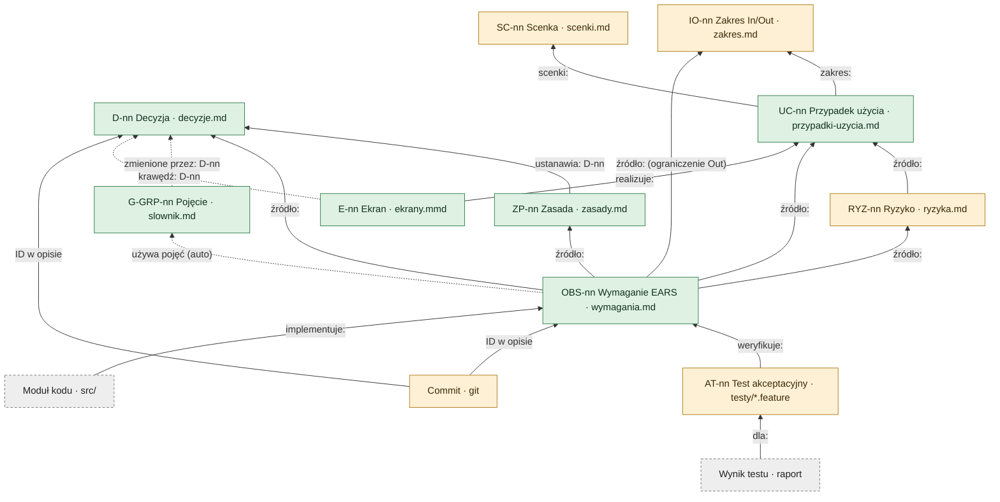

# Model śledzalności człowiek + agent

Każdy rodzaj elementu i pole, którym wskazuje swojego rodzica. Strzałka biegnie od dziecka do rodzica, tak jak zapisuje się ją w pliku (P-03). Kierunek w dół nie jest nigdzie zapisany, tylko liczony przez odwrócenie, więc ślad jest dwukierunkowy z konstrukcji.

jest w gtd2 i sprawdzane brakuje: proponuję do szablonu przyszły etap (kod)

## Warunki pełnej śledzalności

Model daje pełną śledzalność dwukierunkową, gdy spełnia pięć warunków. Każdy da się sprawdzić skryptem.

1. **Korzeń albo rodzic.** Każdy rodzaj jest korzeniem (SC, IO, D) albo ma obowiązkowe pole rodzica.
2. **Kierunek w dół liczony.** Nigdzie nie zapisuje się dzieci; macierz odwraca pola rodziców, więc oba kierunki nie mogą się rozjechać.
3. **Rozwiązywalność.** Każde ID w polu rodzica istnieje i jest unikalne.
4. **Pokrycie.** Dla każdego rodzaju wiadomo, czy brak dzieci to błąd, ostrzeżenie czy stan dopuszczalny.
5. **Przyczyna zmiany.** Każda zmiana (commit) wskazuje decyzję albo element, którego dotyczy.

## Reguły dla każdego rodzaju

| Rodzaj | Pole rodzica | Oczekiwane dzieci | Brak dzieci | W gtd2 |
| --- | --- | --- | --- | --- |
| SC Scenka | korzeń | ≥ 1 UC | ostrzeżenie | brak pliku |
| IO Zakres | korzeń | In: ≥ 1 UC · Out: opcjonalnie wymaganie-ograniczenie | ostrzeżenie dla In | tylko w rozmowie |
| D Decyzja | korzeń | ≥ 1 artefakt albo commit | ostrzeżenie | jest |
| ZP Zasada | `ustanawia: D` | ≥ 1 wymaganie | ostrzeżenie | ZP-01 bez D |
| UC Przypadek | `scenki:`, `zakres:` | ≥ 1 wymaganie, ≥ 1 ekran (projekty z UI) | ostrzeżenie | bez rodzica |
| RYZ Ryzyko | `źródło: UC` | ≥ 1 wymaganie If–then | błąd | odłożone |
| Wymaganie | `źródło:` (UC, D, ZP, RYZ, IO) | ≥ 1 test | ostrzeżenie → błąd | B1–B5 |
| E Ekran | `realizuje: UC` | — | — | brak powiązania |
| AT Test | `weryfikuje:` | wynik (etap kodu) | — | fala 4 |
| Commit | ID w opisie | — | błąd (hook commit-msg) | tylko zwyczaj |